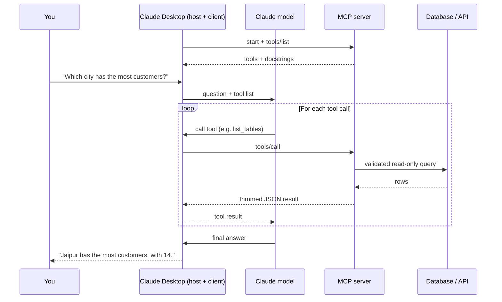

# MCP Server Toolkit

**Secure Model Context Protocol servers that give AI assistants safe, read-only access to databases, GitHub and your documentation.**


<!-- Replace with your demo recording -->


---

## Table of contents

- [Why this project](#why-this-project)
- [What's inside](#whats-inside)
- [How it works](#how-it-works)
- [Quick start](#quick-start)
- [Connect to Claude Desktop](#connect-to-claude-desktop)
- [Example conversations](#example-conversations)
- [Remote mode (HTTP)](#remote-mode-http)
- [Security](#security)
- [Testing](#testing)
- [Project structure](#project-structure)
- [Roadmap](#roadmap)
- [License](#license)

---

## Why this project

LLMs are smart but blind: they cannot see your database, your repos or your docs. The usual fix is custom integration code for every app and every data source.

**MCP (Model Context Protocol)** is an open standard that solves this. Build a capability once as an MCP server, and any MCP client (Claude Desktop, Claude Code, Cursor and others) can discover and use it.

This toolkit implements three such servers, with a focus on **safety**: every tool is read-only, validated, rate-limited and tested against misuse.

## What's inside

| Server | What it does | Tools |
| --- | --- | --- |
| **SQL Explorer** | Lets the model explore and query a whitelisted set of SQLite databases (`shop`, `inventory`, `hr`) in read-only mode | `list_databases`, `list_tables`, `describe_table`, `run_readonly_query` |
| **GitHub Analyzer** | Summarises public repositories, issues and commits | `get_repo_summary`, `list_open_issues`, `recent_commits` |
| **Docs RAG** | Semantic search over your documentation, returning passages with sources | `search_docs` |

Also included:

- **Resources:** `schema://shop`, `schema://inventory`, `schema://hr` expose each database's full schema as context.
- **Prompts:** `sales_report(month)` and `analyse_repo(owner, repo)` templates.

## How it works



1. On startup, Claude Desktop launches each server and asks which tools it offers.
2. When you ask a question, the model decides which tools to call and with what arguments.
3. The server validates the input, runs the tool safely, and returns a small JSON result.
4. The model loops through tool calls until it can answer you.

The model does the thinking (which tool, what SQL). The server does the safe execution.

## Quick start

### Prerequisites

- Python 3.14+ (`uv` will install it automatically if missing)
- [uv](https://docs.astral.sh/uv/)
- Node.js (only for MCP Inspector)
- [Claude Desktop](https://claude.ai/download)

### Install

```bash
git clone https://github.com/akshatjain122004/MCP_Server_Toolkit.git
cd MCP_Server_Toolkit
uv sync
cp .env.example .env        # then add your GitHub token
```

`.env`:

```text
GITHUB_TOKEN=github_pat_xxxxxxxx   # fine-grained, read-only public repo access
MCP_API_KEY=change-me              # only needed for HTTP mode
```

### Prepare data

```bash
uv run scripts/seed_db.py                  # creates data/shop.db with fake data
uv run scripts/seed_inventory.py           # creates data/inventory.db with fake data
uv run scripts/seed_hr.py                  # creates data/hr.db with fake data
uv run servers/docs_rag/build_index.py     # builds the docs vector index
```

### Try a server in MCP Inspector

```bash
uv run mcp dev servers/sql_explorer/server.py
```

A browser tab opens where you can list tools and call them by hand.

## Connect to Claude Desktop

Open **Settings → Developer → Edit Config** and add the servers. Use **absolute paths**.

```json
{
  "mcpServers": {
    "sql-explorer": {
      "command": "uv",
      "args": ["--directory", "/absolute/path/to/mcp-toolkit", "run", "servers/sql_explorer/server.py"]
    },
    "github-analyzer": {
      "command": "uv",
      "args": ["--directory", "/absolute/path/to/mcp-toolkit", "run", "servers/github_analyzer/server.py"]
    },
    "docs-rag": {
      "command": "uv",
      "args": ["--directory", "/absolute/path/to/mcp-toolkit", "run", "servers/docs_rag/server.py"]
    }
  }
}
```

Fully quit and reopen Claude Desktop. The tools appear under the tools icon in the chat box.

> **Tools not showing?** Check **Settings → Developer → Open Logs Folder**. The usual causes are a relative path or `uv` not being on your PATH (use the full path to `uv` in `command`).

## Example conversations

| You ask | What happens |
| --- | --- |
| "Which 5 customers spent the most in October?" | `list_databases` → `describe_table` → `run_readonly_query` with a GROUP BY → ranked answer |
| "Which warehouse has the most stock of item X?" | `list_databases` picks `inventory` → `describe_table` → `run_readonly_query` |
| "Is the fastapi repo active, and what are people complaining about?" | `get_repo_summary` + `recent_commits` + `list_open_issues` → combined summary |
| "How do I configure authentication in this project?" | `search_docs` → answer with steps and cited source files |
| "Delete all orders." | Refused: only single `SELECT` statements are allowed and the connection is read-only |

## Remote mode (HTTP)

Servers can also run as web services with API-key authentication:

```bash
uv run servers/sql_explorer/server.py --http     # serves http://localhost:8000/mcp
```

Every request must include:

```text
Authorization: Bearer <MCP_API_KEY>
```

Requests without a valid key get `401 unauthorized`.

Docker:

```bash
docker build -t mcp-sql-explorer -f servers/sql_explorer/Dockerfile .
docker run -p 8000:8000 --env-file .env mcp-sql-explorer
```

> API-key auth keeps this project simple. Production MCP deployments should use OAuth 2.1 as defined in the MCP specification.

## Security

A model chooses the tool inputs, and a model can be tricked, so every input is treated as untrusted.

| Risk | Mitigation |
| --- | --- |
| Destructive SQL (`DROP`, `DELETE`) | Two layers: SELECT-only validation **and** a read-only SQLite connection (`mode=ro`) |
| Huge or slow queries | Row cap of 100 and a query timeout |
| Leaked secrets | Tokens only in `.env` (gitignored); least-privilege, read-only GitHub token |
| Prompt injection in fetched data | All tools are read-only, so a tricked model cannot cause harm; data is returned, never executed |
| Malformed input | Pydantic constraints (patterns, bounds) enforced in the tool schema |
| API abuse | Per-tool rate limiter |
| Information leakage | Short error messages, no stack traces or file paths |
| Unauthorised remote access | API key required in HTTP mode |

Every tool call is logged (tool, arguments, duration, result) to stderr.

## Testing

```bash
uv run pytest
```

| Layer | What it checks |
| --- | --- |
| Unit | Each tool's logic, including attack queries such as `DROP TABLE` and stacked statements |
| Protocol | Each server starts through the MCP SDK client and lists the expected tools |
| End to end | A manual question set in `tests/e2e_questions.md`, run in Claude Desktop |

GitHub API calls are mocked, so tests never touch the network. Tests run on every push via GitHub Actions.

## Project structure

```
mcp-toolkit/
├── servers/
│   ├── sql_explorer/       # read-only database tools
│   ├── github_analyzer/    # GitHub REST API tools
│   ├── docs_rag/           # retrieval tool + index builder
│   └── hello/              # minimal example server
├── common/                 # logging and rate limiting
├── data/                   # sample DB and vector index
├── scripts/                # data seeding
├── tests/                  # unit, protocol and e2e tests
├── CLAUDE.md               # guidance for Claude Code
└── README.md
```

## Tech stack

Python · FastMCP (official MCP Python SDK) · Pydantic · httpx · SQLite · ChromaDB · pytest · uv · Docker · GitHub Actions

## Roadmap

- [ ] OAuth 2.1 for remote servers
- [ ] PostgreSQL support in SQL Explorer
- [ ] SQL parsing with `sqlglot` instead of regex validation
- [ ] Response caching for the GitHub Analyzer
- [ ] Publish servers to PyPI for `uvx` installs

## Contributing

Issues and pull requests are welcome. Please run `uv run pytest` before submitting and follow the conventions in [CLAUDE.md](CLAUDE.md).

## License

MIT. See [LICENSE](LICENSE).

## Author

**Akshat Jain**, B.Tech in AI & Data Science, College of Technology and Engineering, Udaipur

- GitHub: [@akshatjain122004](https://github.com/akshatjain122004)
- LinkedIn: [akshatjain122004](https://linkedin.com/in/akshatjain122004)